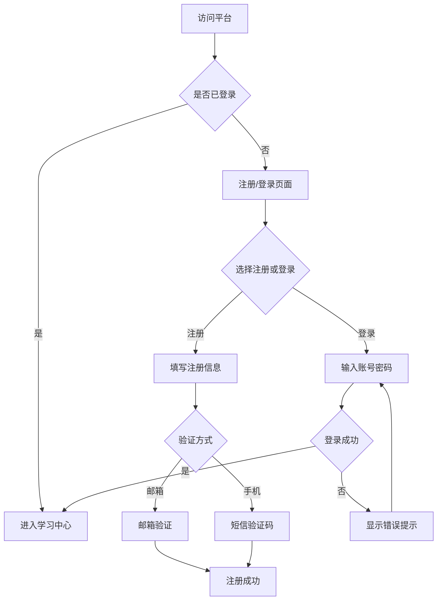
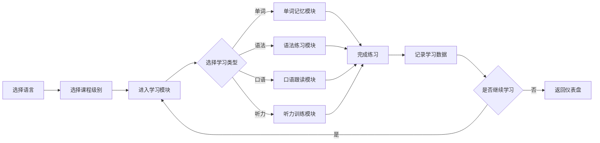

# 多语种在线教育平台产品需求文档

## 1. 产品概述

一款沉浸式多语种在线语言学习平台，支持英语、日语、韩语等主流语言的学习。平台通过互动式学习体验、智能进度追踪和个性化推荐，帮助用户高效掌握目标语言。

### 1.1 产品定位
- 面向语言学习者的一站式平台
- 结合游戏化元素提升学习动力
- 注重听说读写全方位能力培养

### 1.2 目标用户
- 初学者：从零开始学习新语言
- 进阶者：提升现有语言水平
- 考试备考者：为各类语言考试做准备

---

## 2. 核心功能

### 2.1 用户角色

| 角色 | 注册方式 | 核心权限 |
|------|----------|----------|
| 游客 | 无需注册 | 浏览公开课程、查看应用介绍 |
| 注册用户 | 邮箱/手机注册 | 完整学习功能、进度追踪、社区互动 |
| 管理员 | 后台创建 | 课程管理、用户管理、数据统计 |

### 2.2 功能模块总览

1. **首页/仪表盘**
   - 学习概览与今日任务
   - 学习统计可视化
   - 快捷学习入口

2. **课程体系**
   - 分级课程浏览与选择
   - 课程详情与章节列表
   - 学习进度显示

3. **互动学习模块**
   - 单词记忆（闪卡、测验）
   - 语法练习（选择题、填空题）
   - 口语跟读（录音、评分）
   - 听力训练（听写、选择题）

4. **个人中心**
   - 学习进度追踪
   - 学习数据分析
   - 成就展示
   - 设置与偏好

5. **社区模块**
   - 学习小组
   - 经验分享
   - 问答互助

6. **个性化推荐**
   - 学习路径推荐
   - 薄弱环节强化
   - 学习计划定制

---

## 3. 核心流程

### 3.1 用户注册登录流程

### 3.2 学习流程

---

## 4. 用户界面设计

### 4.1 设计风格

**设计理念：现代简洁 + 活力动感**

| 设计元素 | 规范 |
|----------|------|
| 主色调 | #4F46E5（靛蓝色）传递信任与专业 |
| 辅助色 | #10B981（翡翠绿）代表成长与进步 |
| 强调色 | #F59E0B（琥珀橙）用于重要提示和成就 |
| 背景色 | #F8FAFC（浅灰白）减少视觉疲劳 |
| 深色主题 | #1E293B（深蓝灰）支持深色模式 |

### 4.2 字体规范

| 用途 | 字体 | 字号 |
|------|------|------|
| 标题 H1 | Poppins | 32px |
| 标题 H2 | Poppins | 24px |
| 标题 H3 | Poppins | 20px |
| 正文 | Inter | 16px |
| 辅助文字 | Inter | 14px |
| 小标签 | Inter | 12px |

### 4.3 按钮样式

| 类型 | 样式 | 圆角 |
|------|------|------|
| 主要按钮 | 实心靛蓝色 | 8px |
| 次要按钮 | 边框透明色 | 8px |
| 成功按钮 | 实心绿色 | 8px |
| 警告按钮 | 实心橙色 | 8px |

### 4.4 页面设计概览

#### 首页/仪表盘
- 顶部导航栏（Logo、搜索、用户头像）
- 学习概览卡片（今日学习时长、连续学习天数、本周进度）
- 快捷学习模块入口（单词、语法、口语、听力）
- 推荐课程轮播
- 学习成就展示
- 底部快捷导航

#### 课程页面
- 语言选择标签栏
- 难度级别筛选
- 课程卡片网格布局
- 课程详情弹窗

#### 学习模块页面
- 全屏学习区域
- 进度条显示
- 计时器
- 操作按钮组
- 即时反馈动画

#### 个人中心
- 用户头像与等级
- 统计数据仪表盘
- 成就徽章墙
- 学习历史列表

#### 社区页面
- 话题分类标签
- 帖子列表
- 发帖与回复功能

---

## 5. 响应式设计

- **桌面优先**：1200px+ 优化布局
- **平板适配**：768px-1199px 双栏布局
- **移动端**：320px-767px 单栏布局，底部导航

---

## 6. 动画与交互

| 场景 | 动画效果 |
|------|----------|
| 页面加载 | 渐入 + 缩放动画，交错延迟 |
| 按钮交互 | hover 放大 1.05，色彩过渡 |
| 答案反馈 | 正确绿色脉冲，错误红色抖动 |
| 成就解锁 | 弹跳 + 粒子特效 |
| 进度更新 | 数字滚动动画 |
| 页面切换 | 滑入/淡入过渡 |

---

## 7. 技术约束

- 使用现代浏览器（Chrome、Firefox、Safari、Edge 最新两个版本）
- 首屏加载时间 < 3秒
- 支持触摸和鼠标交互
- 数据本地存储支持离线学习
