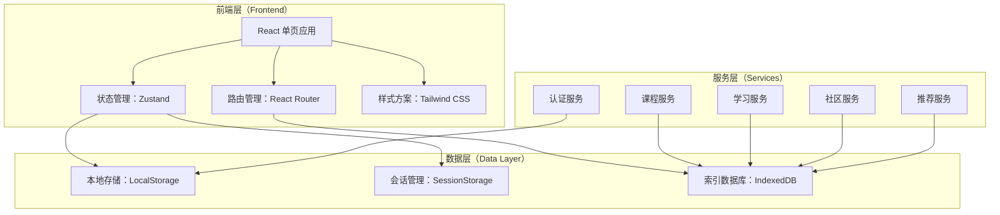
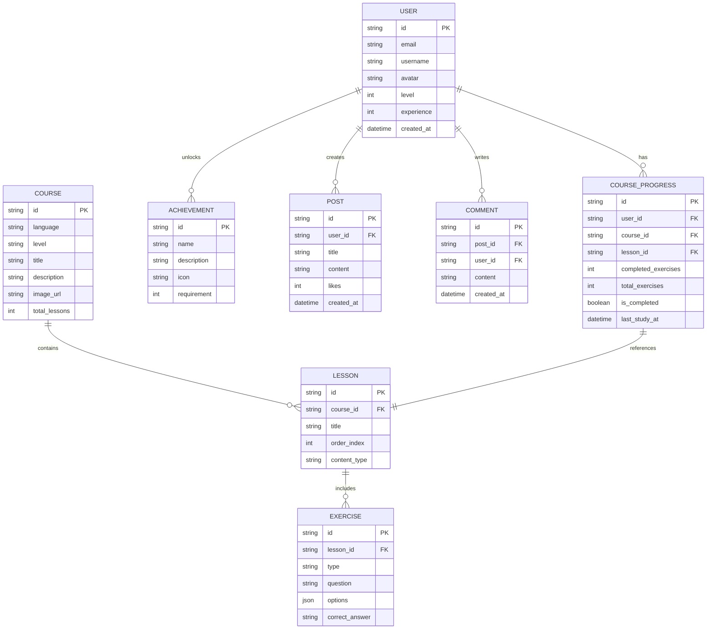

# 多语种在线教育平台技术架构文档

## 1. 架构设计

### 1.1 系统分层架构



### 1.2 技术栈选型

| 层级 | 技术选型 | 说明 |
|------|----------|------|
| 前端框架 | React 18 | 组件化开发，生态完善 |
| 构建工具 | Vite | 极速开发体验 |
| 样式方案 | Tailwind CSS 3 | 原子化CSS，高效开发 |
| 状态管理 | Zustand | 轻量级状态管理 |
| 路由管理 | React Router 6 | SPA 标准路由 |
| 数据存储 | IndexedDB + LocalStorage | 本地持久化数据 |
| 动画方案 | Framer Motion | 流畅交互动画 |
| 图表库 | Recharts | 数据可视化 |

---

## 2. 路由定义

### 2.1 前端路由表

| 路由路径 | 页面名称 | 功能描述 |
|----------|----------|----------|
| `/` | 首页/仪表盘 | 学习概览、快速入口 |
| `/login` | 登录页 | 用户登录 |
| `/register` | 注册页 | 用户注册 |
| `/courses` | 课程中心 | 浏览和选择课程 |
| `/courses/:id` | 课程详情 | 查看课程章节 |
| `/learn/:module` | 学习模块 | 单词/语法/口语/听力 |
| `/progress` | 学习进度 | 个人进度追踪 |
| `/community` | 社区中心 | 话题讨论 |
| `/profile` | 个人中心 | 用户设置与成就 |

---

## 3. 数据模型

### 3.1 实体关系图



---

## 4. 核心模块设计

### 4.1 认证模块（Auth）

**功能职责：**
- 用户注册与登录
- 会话管理
- 权限控制

**数据存储：**
```typescript
// LocalStorage Keys
const AUTH_KEYS = {
  TOKEN: 'auth_token',
  USER: 'current_user',
}
```

### 4.2 课程模块（Course）

**功能职责：**
- 课程目录管理
- 课程难度分级
- 章节内容加载

**数据结构：**
```typescript
interface Course {
  id: string
  language: 'en' | 'ja' | 'ko'
  level: 'beginner' | 'intermediate' | 'advanced'
  title: string
  description: string
  lessons: Lesson[]
}
```

### 4.3 学习模块（Learning）

**功能职责：**
- 单词记忆（闪卡、测验）
- 语法练习（选择题、填空）
- 口语跟读（录音、播放）
- 听力训练（听写、选择）

**四种学习模式：**

| 模式 | 核心交互 | 数据记录 |
|------|----------|----------|
| 单词记忆 | 翻转闪卡、选择记忆 | 正确率、复习次数 |
| 语法练习 | 选择/填空提交 | 答案正确性、用时 |
| 口语跟读 | 录音、对比评分 | 得分、音频存储 |
| 听力训练 | 听写/选择判断 | 正确率、用时 |

### 4.4 进度追踪模块（Progress）

**功能职责：**
- 学习时长统计
- 连续学习天数
- 各模块完成度
- 知识点掌握度

**存储结构：**
```typescript
interface UserProgress {
  totalStudyMinutes: number
  currentStreak: number
  longestStreak: number
  languageProgress: {
    [language: string]: {
      lessonsCompleted: number
      exercisesCompleted: number
      accuracy: number
    }
  }
}
```

### 4.5 个性化推荐模块（Recommendation）

**算法逻辑：**
- 基于学习历史推荐薄弱环节
- 基于完成度推荐下一课程
- 基于兴趣标签推荐相关话题

**推荐策略：**
```typescript
interface Recommendation {
  type: 'review' | 'continue' | 'suggest'
  target: string
  reason: string
  priority: number
}
```

### 4.6 社区模块（Community）

**功能职责：**
- 话题发布与浏览
- 评论与回复
- 点赞互动

### 4.7 成就系统（Achievement）

**成就类型：**

| 类别 | 成就名称 | 条件 |
|------|----------|------|
| 入门 | 初学者 | 完成第一节课 |
| 连续 | 7日坚持 | 连续学习7天 |
| 熟练 | 语法大师 | 语法正确率≥90% |
| 口语 | 口语达人 | 口语练习≥100次 |
| 听力 | 听力满分 | 听力正确率100% |
| 全面 | 全能学习者 | 完成所有模块 |

---

## 5. 性能优化策略

### 5.1 首屏加载优化
- 路由懒加载
- 图片资源压缩
- CSS 样式抽取

### 5.2 运行性能
- React.memo 减少重渲染
- useMemo/useCallback 缓存计算
- 虚拟列表优化长列表

### 5.3 数据缓存
- LocalStorage 缓存用户数据
- IndexedDB 存储学习进度
- SessionStorage 管理临时数据

---

## 6. 目录结构

```
src/
├── components/          # 通用组件
│   ├── common/         # Button, Input, Card 等
│   ├── layout/         # Header, Footer, Sidebar
│   └── learning/       # 学习相关组件
├── pages/              # 页面组件
│   ├── Home/           # 首页
│   ├── Auth/           # 登录注册
│   ├── Course/         # 课程相关
│   ├── Learning/       # 学习模块
│   ├── Progress/       # 进度追踪
│   ├── Community/       # 社区模块
│   └── Profile/        # 个人中心
├── services/           # 业务服务层
│   ├── auth.ts
│   ├── course.ts
│   ├── learning.ts
│   └── progress.ts
├── stores/             # 状态管理
│   ├── authStore.ts
│   ├── courseStore.ts
│   └── progressStore.ts
├── hooks/              # 自定义 Hooks
├── utils/              # 工具函数
├── data/               # 静态数据
└── styles/             # 全局样式
```
